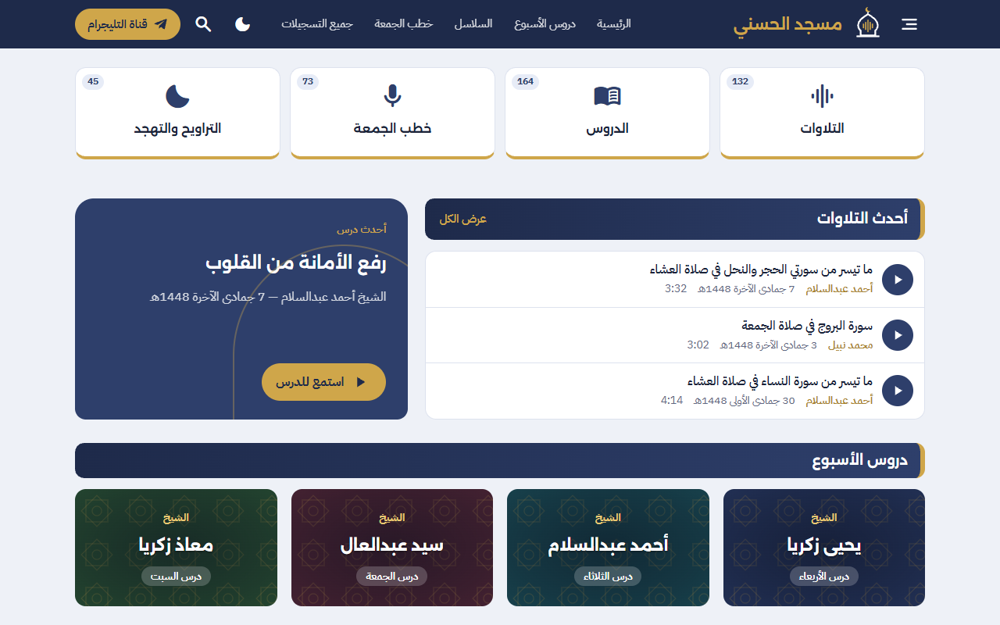
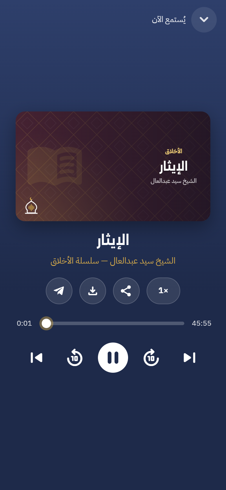
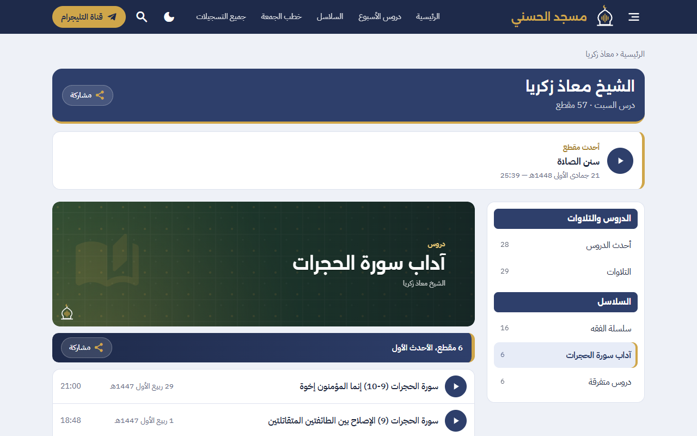
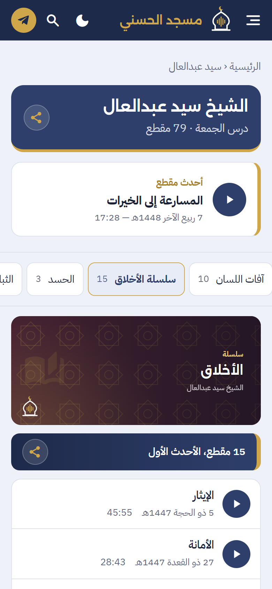
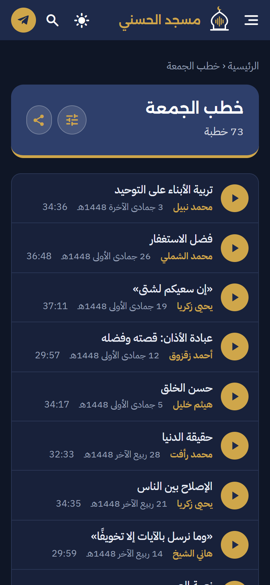
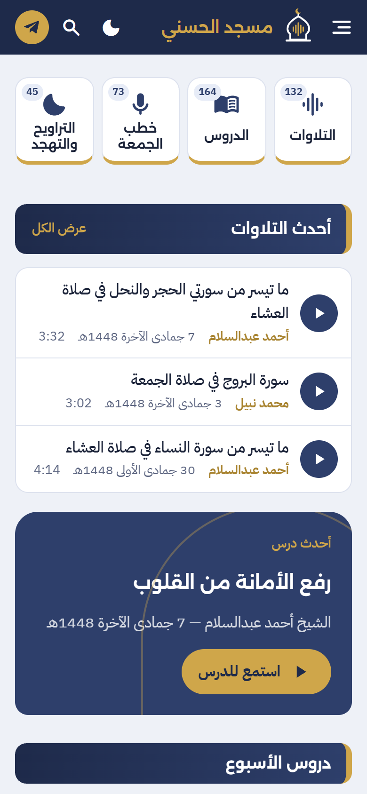

# Masjed Al-Hasany

The website of **Masjed Al-Hasany**. It hosts the mosque's lessons, Friday sermons and Quran recitations, published from its Telegram channel [@masjed_alhasany](https://t.me/masjed_alhasany).

🌐 **[masjed-alhasany.vercel.app](https://masjed-alhasany.vercel.app)**

Visitors browse by sheikh → series → lesson and listen right on the site, without needing Telegram. The site shows exactly what is on the channel, nothing more. It is a static site on **Vercel**, and the audio is stored in **GitHub Releases**.

<p align="center">
  
  
</p>

> **Want a site like this for your mosque?** Use **[mosque-media](https://github.com/buggYateer/mosque-media)**. It is the open-source, configurable version of this project, with a step-by-step setup guide.

---

## Features

- **Browse by sheikh, series and type.** Lessons, Friday sermons, recitations, weekly lessons, latest uploads, most listened, and search.
- **Built-in player.** Remembers where you stopped, offers playback speed, plays the next lesson automatically, and works from the lock screen. Downloads save with the Arabic lesson title.
- **Admin dashboard (`/lawha`), password-protected.** Edit titles, sheikhs, types, dates and series, hide or add clips, and pick featured lessons from any device.
- **Installable app (PWA)** with a dark mode, Arabic RTL layout, and a fast mobile-first design.

<p align="center">
  
</p>
<p align="center">
  
  
  
</p>

## How it works

```
Telegram channel @masjed_alhasany ──▶ data/ (channel export + captions)
                                           │
                               tools/build_data.py
                                           ▼
                                  web/lessons.json ──git push──▶ Vercel (website)
local audio ──tools/update_site.py──▶ GitHub Releases (audio-0, audio-1, …)
Dashboard edits ──▶ web/overrides.json (saved to GitHub by the /lawha page)
```

- **Lessons** come from the channel's audio posts. Titles come from the latest caption (the text after `|` if present).
- **Series titles** come from the channel's index posts.
- **Audio URL:** `https://github.com/buggYateer/alhasany-site/releases/download/audio-<id ÷ 500>/<id>.mp3`
- **Fixes** approved by the channel owner live in `fixes/` (captions, series titles, dates, sheikhs).

## Weekly update

A single command builds the data, uploads any new audio to GitHub Releases, and publishes the site:

```bash
python tools/update_site.py
```

| Flag | Effect |
|---|---|
| `--dry` | Show what would happen without uploading anything |
| `--no-push` | Upload the audio but don't publish the site |

The script runs `git pull` first, so it never overwrites edits made from the dashboard.

## Admin dashboard (`/lawha`)

- Edits are saved to `web/overrides.json` on GitHub. The site applies them on top of `lessons.json`, and Vercel redeploys automatically.
- New audio uploaded from the dashboard goes to `incoming/<id>.mp3`. A GitHub Actions workflow (`.github/workflows/incoming.yml`) moves it into the right `audio-N` release.

**One-time setup:** in Vercel → Settings → Environment Variables, add:

- `ADMIN_PASSWORD`: the dashboard password
- `GITHUB_TOKEN`: a fine-grained token scoped to this repository with *Contents: Read and write*

Then redeploy.

## Local preview

```bash
python tools/serve.py
```

Then open http://localhost:8765. Audio is served from the local files.

## Project structure

| Path | Purpose |
|---|---|
| `web/` | The static site served by Vercel: `index.html`, `app.js`, `style.css`, `lessons.json`, `overrides.json`, and the dashboard in `lawha/` |
| `web/img/sheikhs/` | Sheikh photos, named after the sheikh (for example `يحيى_زكريا.jpg`) |
| `api/` | Vercel Edge functions: `dl` (downloads with the Arabic title), `admin` (dashboard login and saving), `channel` (latest channel posts) |
| `tools/build_data.py` | Builds `web/lessons.json` from the channel data |
| `tools/update_site.py` | The weekly update: build, upload audio, publish |
| `tools/serve.py` | Local preview server |
| `tools/missing_audio.txt` | Posts whose audio file isn't available. They show on the site with a Telegram link only |
| `fixes/` | Corrections approved by the channel owner |
| `.github/workflows/incoming.yml` | Moves audio uploaded from the dashboard into GitHub Releases |

## Security

- No secrets are stored in the repository. The dashboard password and GitHub token are Vercel environment variables.
- The GitHub token is fine-grained and limited to this one repository.
